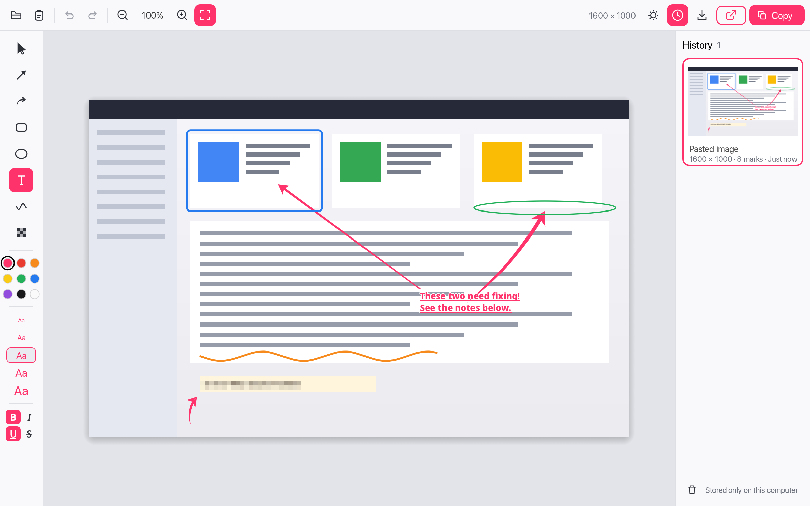
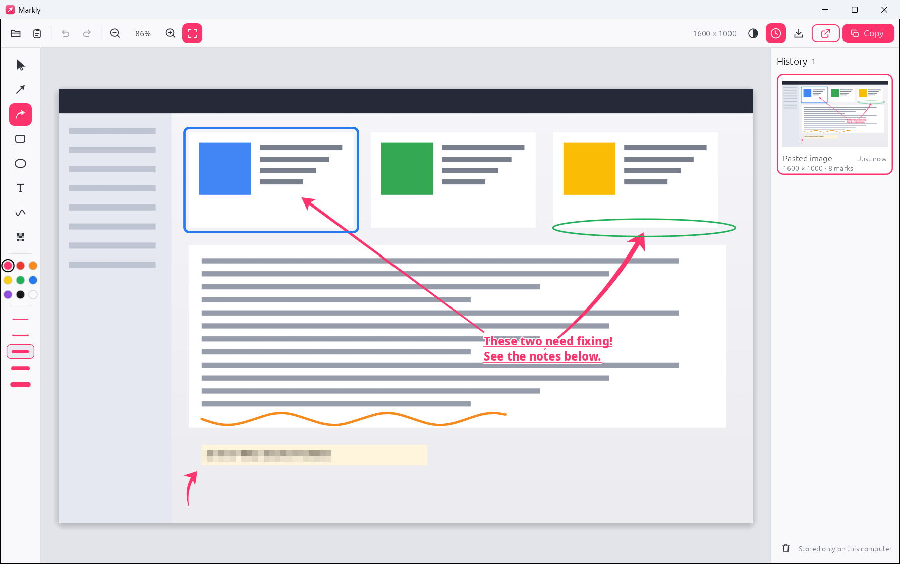
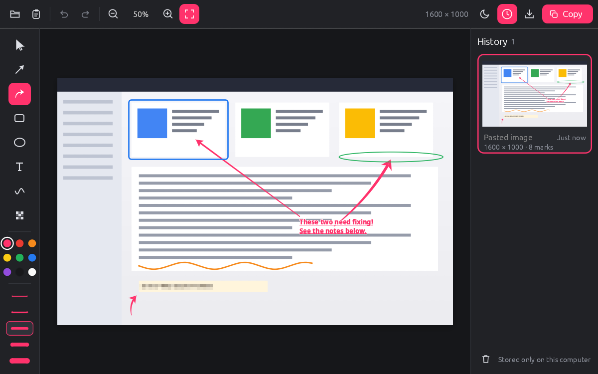

# Skrib

A small, fast, local-first image annotation utility for Windows, macOS and
Linux. Built with Rust and egui.

**Paste an image, annotate it, copy the result, close the app.** Your work is
remembered automatically, even if you never save it.

**Website and downloads:** [skrib.developitbest.com](https://skrib.developitbest.com)

<sub>Formerly called Markly (up to 0.1.10). Your existing history moves over
automatically the first time Skrib starts.</sub>


<sub>macOS</sub>


<sub>Windows</sub>


<sub>Linux</sub>

## Features

- **Paste** an image (Ctrl/⌘+V), **open** a file, **drag & drop**, or pass a
  file on the command line. PNG, JPEG and WebP.
- **Annotate** with clean straight arrows or bold curved arrows, rounded rectangles, ellipses, multi-line text,
  smooth freehand strokes and **pixelation** that really destroys the
  underlying pixels.
- Text labels can be **bold**, *italic*, underlined and ~~struck through~~
  (the whole label; toggles in the tool rail or ⌘/Ctrl+B, I, U, Shift+X).
- Every annotation stays **editable**: select, move, resize with handles,
  recolour, delete, undo/redo.
- **Copy** (Ctrl/⌘+C) puts the flattened image, at the original resolution,
  on the system clipboard, ready to paste into a browser, chat app or editor.
- **Export** to PNG or JPEG.
- **Drag out** (macOS, Windows): drag the grip handle next to Copy onto the
  desktop or into another app to drop the annotated image as a PNG file.
- **Automatic local history.** Every pasted or opened image becomes a working
  document that is autosaved and restored on the next launch. A history
  panel with thumbnails lets you reopen or delete earlier documents.
- A small curated palette; the signature pink (`#FF336C`) is the default. The chosen colour is shared by all tools.
- Light and dark themes (follows the system by default).

What it deliberately does *not* do: no screen capture, no cloud, no accounts,
no telemetry, no network access at all, no tray icon or background service,
no web view.

## Keyboard shortcuts

`Cmd` means Ctrl on Windows/Linux and ⌘ on macOS.

| Action | Shortcut |
|---|---|
| Paste image | Cmd+V |
| Copy annotated image | Cmd+C |
| Open image | Cmd+O |
| Export image | Cmd+Shift+S (or Cmd+S) |
| Undo / Redo | Cmd+Z / Cmd+Shift+Z (also Cmd+Y) |
| Bold / Italic / Underline / Strikethrough (text) | Cmd+B / Cmd+I / Cmd+U / Cmd+Shift+X |
| Delete selected annotation | Delete / Backspace |
| Cancel drag / clear selection / finish text | Escape |
| Fit image / Actual size (1:1) | Cmd+0 / Cmd+1 |
| Zoom in / out | Cmd+= / Cmd+−, or Cmd+mouse wheel, or pinch |
| Pan | Scroll, drag empty space with Select, middle-drag, or Space+drag |
| Select/move while drawing | Hover an annotation with any drawing tool: it gets a pink outline, and pressing there selects and drags it instead of drawing. Press where nothing is outlined to draw. Inside a pixelated area you always draw (use Select to pick it up there); with the Text tool, clicking a label edits it. |
| Nudge selection | Arrow keys (Shift = 10 px) |
| Tools | V select · A arrow · C curved arrow · R rectangle · E ellipse · T text · P pen · X pixelate |
| Toggle history | H |
| Constrain (15° arrows, squares, circles, symmetric curve) | hold Shift while drawing/resizing |
| Bend a curved arrow | drag the filled middle handle of a selected curved arrow (onto the line = straight) |

While you are typing in a text annotation, Cmd+C/V/X/Z and Delete act on the
text, not on the image.

## Install / run

Download the archive for your platform from the
[latest release](https://github.com/Arsenitim/skrib/releases/latest) and
unpack it. There is no installer and no auto-update.

- **Linux (x86_64):** run `./skrib`. To add Skrib with its icon to your
  application launcher (GNOME, KDE, etc.), run once:
  `./skrib --install-desktop-entry`. This writes `skrib.desktop` and icons
  under `~/.local/share` and points the launcher at the binary's current
  location, so run it again if you move the binary.
  `./skrib --uninstall-desktop-entry` removes them.
- **macOS (Apple Silicon and Intel, one universal app):** move `Skrib.app` to Applications. The app is
  ad-hoc signed but not notarised, so the first launch is blocked. Either
  right-click → Open, or run `xattr -dr com.apple.quarantine /Applications/Skrib.app`.
- **Windows (x86_64):** run `skrib.exe`. It carries the Skrib icon; pin it
  to the taskbar or Start, or create a shortcut, as you like.
- **Linux runtime libraries** (present on virtually every desktop; loaded at
  runtime, so building needs no `-dev` packages):
  `libwayland-client`, `libxkbcommon` (Wayland) or `libX11`, `libXcursor`,
  `libXrandr`, `libXi` (X11), plus `libEGL`/`libGL` (Mesa or a vendor driver).
  File dialogs use the **XDG desktop portal** (`xdg-desktop-portal` plus a
  backend such as `-gnome`, `-kde` or `-gtk`).
  Debian/Ubuntu: `sudo apt install libxkbcommon0 libwayland-client0 libegl1 xdg-desktop-portal`.

### Where documents are stored

| OS | Location |
|---|---|
| Linux | `$XDG_DATA_HOME/skrib` (usually `~/.local/share/skrib`) |
| macOS | `~/Library/Application Support/Skrib` |
| Windows | `%APPDATA%\Skrib\data` |

Each document is a folder containing the untouched original image,
`document.json` (editable annotations) and `thumbnail.png`. The 300 most
recently modified documents are kept; older ones are pruned automatically.
Nothing ever leaves your computer.

## Clipboard notes and platform limitations

- **Linux (X11 and Wayland): paste before you quit.** The clipboard is served
  by the application that copied, so an image copied from Skrib disappears
  from the clipboard when Skrib closes (unless a clipboard manager such as
  Klipper, CopyQ or a GNOME clipboard extension has kept a copy). This is a
  deliberate simplification: no helper process stays behind. Windows and
  macOS keep the copied image after Skrib quits.
- **No drag-out on Linux.** The drag-source APIs available to Rust need a GTK
  window, and Skrib's window is not one; use Copy or Export instead.
- On Wayland, Skrib uses the `wlr/ext-data-control` protocol when the
  compositor offers it, and otherwise the X11 clipboard through XWayland.
  Verified on GNOME 50 (Wayland) only; see [docs/QA_CHECKLIST.md](docs/QA_CHECKLIST.md).
- Images go through the platform's standard image clipboard formats via
  [arboard](https://crates.io/crates/arboard). On Linux that is `image/png`.
  The Windows and macOS formats come from arboard and have not yet been
  checked by hand against other applications (see the QA checklist).
- Copying renders on a background thread. A 4K image takes about 60 ms to
  render and an 8K one about 180 ms, plus the clipboard transfer.
- If the clipboard holds a copied *file* (e.g. from a file manager) or a
  `file://` path to an image, pasting opens that file.

## Building from source

Requires a stable Rust toolchain (1.88 or newer).

```sh
cargo run --release              # run
cargo build --release            # target/release/skrib
cargo fmt && cargo clippy --all-targets && cargo test
```

See [CONTRIBUTING.md](CONTRIBUTING.md) for development aids (scripted UI
runs, screenshots, timing traces) and [docs/ARCHITECTURE.md](docs/ARCHITECTURE.md)
for how the code is organised.

## Performance

Measured, not assumed. See [docs/PERFORMANCE.md](docs/PERFORMANCE.md). On a
2025 laptop (Linux, GNOME Wayland) the first frame appears about 110–150 ms
after launch. A 1600×1000 document is restored within about 50 ms after that,
a 4K one within about 100 ms. Idle CPU use is zero, and shutdown takes a few
milliseconds.

## License

Dual-licensed under either of [MIT](LICENSE-MIT) or
[Apache-2.0](LICENSE-APACHE) at your option.

The bundled annotation font, Noto Sans SemiBold, is © Google and licensed
under the [SIL Open Font License 1.1](assets/fonts/OFL.txt). egui's built-in
UI fonts carry their own licenses (Ubuntu Font Licence, OFL, MIT/Apache).
All icons are original artwork: UI icons in `src/app/icons.rs`; the app icon
is generated by `src/icon.rs` (`cargo run --example make_icons` regenerates
`assets/icons/`).
